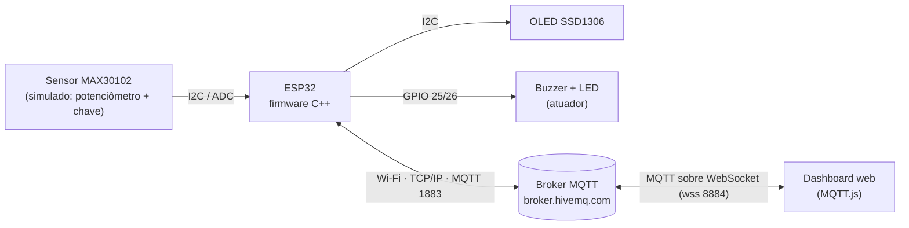
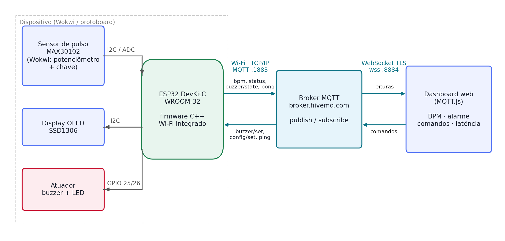
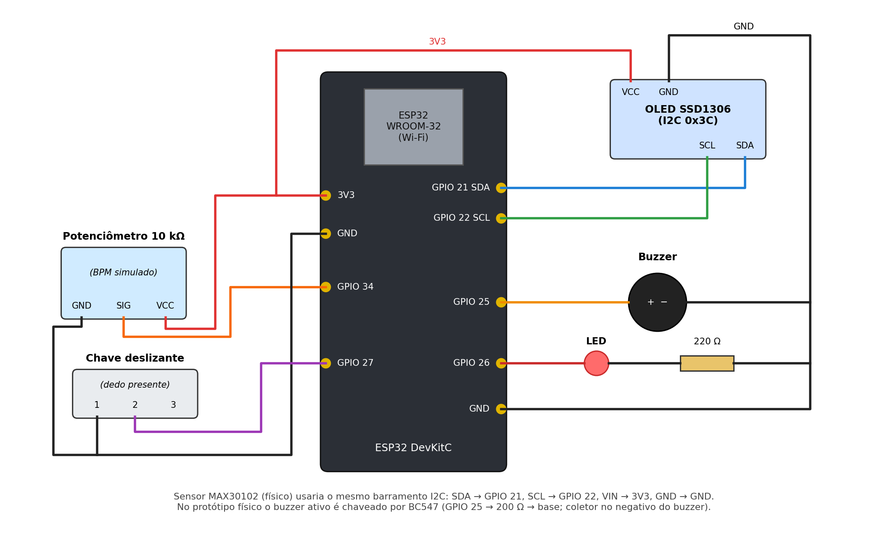

# Monitor de Frequência Cardíaca IoT — ESP32 + MQTT

Protótipo de Internet das Coisas (IoT) desenvolvido para a disciplina **Objetos Inteligentes Conectados**
da Universidade Presbiteriana Mackenzie. Um ESP32 lê a frequência cardíaca, mostra o valor em um display
OLED, aciona um buzzer (com LED indicador) quando a leitura fica fora de uma faixa configurável e publica
tudo pela internet usando o protocolo **MQTT**. Um dashboard web, conectado ao mesmo broker, exibe as
leituras, envia comandos ao atuador e mede o tempo de resposta do sistema.


- Vídeo de demonstração: <https://youtu.be/Ebqnw0Q5lwQ>
- Simulação no Wokwi: <https://wokwi.com/projects/481328094955146241>
- Dashboard online: <https://gustavobjonk.github.io/monitor-cardiaco-iot/dashboard/>

## Sumário

1. [Como funciona](#como-funciona)
2. [Estrutura do repositório](#estrutura-do-repositório)
3. [Reproduzindo no simulador Wokwi](#reproduzindo-no-simulador-wokwi)
4. [Reproduzindo com hardware real](#reproduzindo-com-hardware-real)
5. [Dashboard e comandos](#dashboard-e-comandos)
6. [Medição do tempo de resposta](#medição-do-tempo-de-resposta)
7. [Documentação detalhada](#documentação-detalhada)
8. [Limitações](#limitações)

## Como funciona



1. O sensor detecta cada batimento. O ESP32 calcula o BPM pela média móvel dos últimos 4 intervalos
   entre batimentos.
2. O BPM aparece no OLED e é publicado em `<base>/bpm` (JSON).
3. Se a média ficar fora da faixa (padrão 50–120 BPM) por 3 leituras seguidas, o alarme liga o buzzer e o
   LED, e o novo estado é publicado em `<base>/buzzer/state`.
4. O dashboard (ou qualquer cliente MQTT) pode ligar, silenciar, voltar ao modo automático ou dar um bip
   publicando em `<base>/buzzer/set`, e pode mudar a faixa em `<base>/config/set`.
5. Se o ESP32 cair, o broker publica a *Last Will* `{"online":false}` em `<base>/status`.

O prefixo `<base>` padrão é `upm/iot/hr-monitor-01`. Como o broker é público, troque-o por um valor
próprio no firmware (`TOPIC_BASE`) e no dashboard.

## Estrutura do repositório

| Caminho | Conteúdo |
|---|---|
| `firmware/monitor_cardiaco/monitor_cardiaco.ino` | Firmware do ESP32 (Arduino C++), comentado |
| `wokwi/diagram.json` | Circuito para o simulador Wokwi |
| `wokwi/libraries.txt` | Bibliotecas usadas pelo Wokwi |
| `dashboard/index.html` | Dashboard web MQTT (abre direto no navegador) |
| `tools/grafico_latencia.py` | Gera a tabela e os gráficos de tempo de resposta a partir do CSV |
| `docs/hardware.md` | Componentes, pinagem, alimentação, montagem |
| `docs/mqtt.md` | Protocolo, tópicos, mensagens, QoS, retenção, Last Will |
| `docs/firmware.md` | Arquitetura do código, fluxograma e funções |
| `docs/medicoes.md` | Metodologia e resultados das medições de latência |
| `docs/img/` | Arquitetura, diagrama de montagem, fluxogramas e sequência MQTT (PNG) |




## Reproduzindo no simulador Wokwi

O simulador [Wokwi](https://wokwi.com) não tem o MAX30102. Nele o sensor é representado por um
**potenciômetro** (define a frequência simulada, 30–180 BPM) e uma **chave deslizante** (indica se o dedo
está no sensor). Todo o resto (Wi-Fi, MQTT, OLED, buzzer, LED) roda como no hardware real, e o ESP32
simulado acessa a internet de verdade pela rede `Wokwi-GUEST`.

> Atalho: o projeto pronto está em <https://wokwi.com/projects/481328094955146241> (basta clicar em ▶). Para montar do zero:

1. Abra <https://wokwi.com/projects/new/esp32>.
2. Cole o conteúdo de `firmware/monitor_cardiaco/monitor_cardiaco.ino` em `sketch.ino`.
3. Cole o conteúdo de `wokwi/diagram.json` em `diagram.json`.
4. Crie `libraries.txt` pelo **Library Manager** (adicione `PubSubClient`, `Adafruit SSD1306`,
   `Adafruit GFX Library`, `ArduinoJson`) ou cole `wokwi/libraries.txt`.
5. Clique em ▶. No *Serial Monitor* devem aparecer `[WiFi] conectando... OK` e `[MQTT] conectado`.
6. Mova a chave para a posição que liga o pino 27 ao GND (dedo presente) e gire o potenciômetro.

## Reproduzindo com hardware real

1. Monte o circuito de `docs/hardware.md` (MAX30102 e OLED no I2C, GPIO 21/22; buzzer via BC547 no GPIO 25;
   LED com resistor de 220 Ω no GPIO 26).
2. Na Arduino IDE, instale o suporte às placas ESP32 (Espressif) e as bibliotecas `PubSubClient`,
   `Adafruit SSD1306`, `Adafruit GFX Library`, `ArduinoJson` (v7) e `SparkFun MAX3010x Pulse and
   Proximity Sensor Library`.
3. No início do firmware, mude `USE_SIMULATED_SENSOR` para `0` e preencha `WIFI_SSID` e `WIFI_PASS`.
4. Selecione a placa *ESP32 Dev Module* e envie o código.

> O modo real (`USE_SIMULATED_SENSOR 0`) usa o algoritmo `checkForBeat()` da biblioteca SparkFun e não
> foi testado em hardware físico neste trabalho; os resultados apresentados vêm da simulação no Wokwi.

## Dashboard e comandos

Abra `dashboard/index.html` no navegador (não precisa de servidor), confira o broker
(`wss://broker.hivemq.com:8884/mqtt`) e o prefixo, e clique em **Conectar**. O painel mostra o BPM, o
gráfico das últimas leituras, o estado do dedo/alarme/atuador e um log de todas as mensagens MQTT.

Também é possível usar qualquer cliente MQTT, por exemplo o
[MQTT Explorer](https://mqtt-explorer.com/) ou o `mosquitto_pub`:

```bash
mosquitto_sub -h broker.hivemq.com -t "upm/iot/hr-monitor-01/#" -v
```

```bash
mosquitto_pub -h broker.hivemq.com -t "upm/iot/hr-monitor-01/buzzer/set" -m '{"state":"beep","id":"t1"}'
```

## Medição do tempo de resposta

No dashboard, **Medir atuador (4x)** e **Medir sensor (4x)** fazem quatro medições cada e calculam a
média; **Exportar CSV** salva os dados. Depois:

```bash
pip install matplotlib
python tools/grafico_latencia.py medicoes_latencia.csv
```

O script imprime a tabela (formato do artigo) e salva `latencia.png`. A metodologia está em
`docs/medicoes.md`.

## Documentação detalhada

- [Hardware](docs/hardware.md)
- [Protocolo MQTT e interfaces](docs/mqtt.md)
- [Firmware](docs/firmware.md)
- [Medições](docs/medicoes.md)

## Limitações

- O sensor foi simulado; não houve validação fisiológica das leituras.
- O broker público não tem autenticação nem criptografia na porta 1883. Dados reais de saúde exigiriam
  broker privado com TLS (porta 8883) e usuário/senha.
- O tempo de resposta inclui a latência da internet até o broker público e o desempenho do simulador.

## Licença

MIT.
