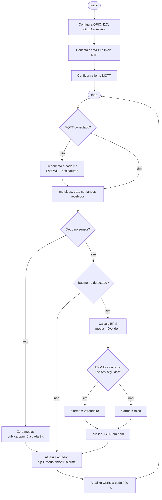
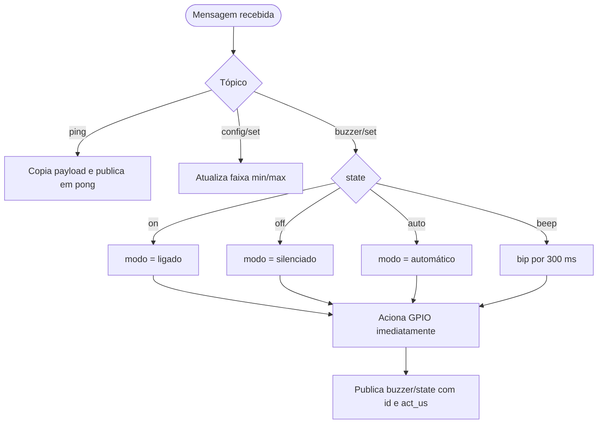

# Firmware

Arquivo único: `firmware/monitor_cardiaco/monitor_cardiaco.ino` (Arduino C++, núcleo ESP32 da Espressif).

## Bibliotecas

| Biblioteca | Uso |
|---|---|
| `WiFi.h` (núcleo ESP32) | conexão Wi-Fi |
| `PubSubClient` | cliente MQTT 3.1.1 |
| `Adafruit SSD1306` + `Adafruit GFX Library` | display OLED |
| `ArduinoJson` (v7) | montagem e leitura das mensagens JSON |
| `SparkFun MAX3010x` (`MAX30105.h`, `heartRate.h`) | sensor real (apenas com `USE_SIMULATED_SENSOR 0`) |
| `time.h` / `sys/time.h` | NTP (`configTime`) para carimbo de tempo das mensagens |

## Estrutura

| Função | Responsabilidade |
|---|---|
| `setup()` | configura pinos, I2C a 400 kHz, OLED, sensor, tópicos, Wi-Fi, NTP e cliente MQTT |
| `loop()` | reconexão sem bloqueio, `mqtt.loop()`, leitura do sensor, publicação "sem dedo", atuador, OLED |
| `detectBeat()` | lê o sensor e retorna `true` quando há um batimento |
| `onBeat()` | calcula o BPM (média móvel de 4 intervalos), avalia o alarme e publica em `bpm` |
| `updateActuator()` | decide a saída do buzzer/LED a partir do modo, do alarme e de um bip pendente |
| `driveBuzzer()` | aciona fisicamente os GPIO 25 e 26 |
| `onMqttMessage()` | trata `buzzer/set`, `config/set` e `ping` |
| `publishBuzzerState()` | publica o estado do atuador (retido), ecoando o `id` do comando |
| `mqttConnect()` | conecta com Last Will, publica `status` e assina os tópicos de comando |
| `drawOled()` | desenha a tela (estado da rede, BPM, batimento, alarme, modo) |

O `loop()` não usa `delay()` depois do `setup()`: todas as temporizações comparam `millis()`, para que o
sensor seja lido o mais rápido possível enquanto o MQTT e o display são atendidos.

## Fluxograma



Fluxo do comando remoto (dentro de `mqtt.loop()`):



## Pseudocódigo do cálculo de BPM e do alarme

```
ao detectar batimento no instante t:
    se é o primeiro batimento: guarda t e sai
    intervalo ← t − último_t;  último_t ← t
    instantâneo ← 60000 / intervalo
    se instantâneo < 20 ou > 250: descarta (ruído)
    janela[ i mod 4 ] ← instantâneo
    bpm ← média(janela)
    se janela cheia e (bpm < mín ou bpm > máx): fora ← fora + 1  senão: fora ← 0
    alarme ← (fora ≥ 3)
    publica {"bpm", "inst", "finger", "alarm", "seq", "ts", "proc_us"}
```

## Problema encontrado durante os testes

No primeiro teste, a resposta ao `ping` chegava corrompida (`ongongong...`). O ponteiro `payload`
recebido no *callback* do PubSubClient aponta para o buffer interno da biblioteca, e o `publish()`
reescreve esse buffer ao montar o pacote de saída. A correção foi copiar o payload para um buffer local
antes de publicar a resposta. Nos comandos do buzzer, o `state` e o `id` já são copiados para `String`
antes do `publish()`, por isso não eram afetados.

## Modos de compilação

- `USE_SIMULATED_SENSOR 1` (padrão): Wokwi; buzzer acionado com `tone()` (o buzzer do Wokwi é piezo).
- `USE_SIMULATED_SENSOR 0`: MAX30102 real; buzzer ativo com `digitalWrite()` via BC547. Preencher
  `WIFI_SSID`/`WIFI_PASS`.
