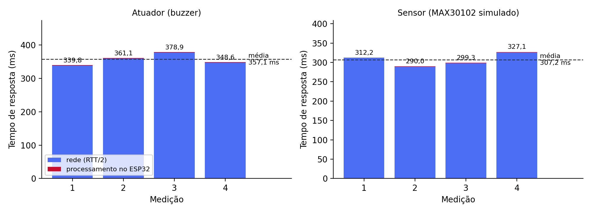
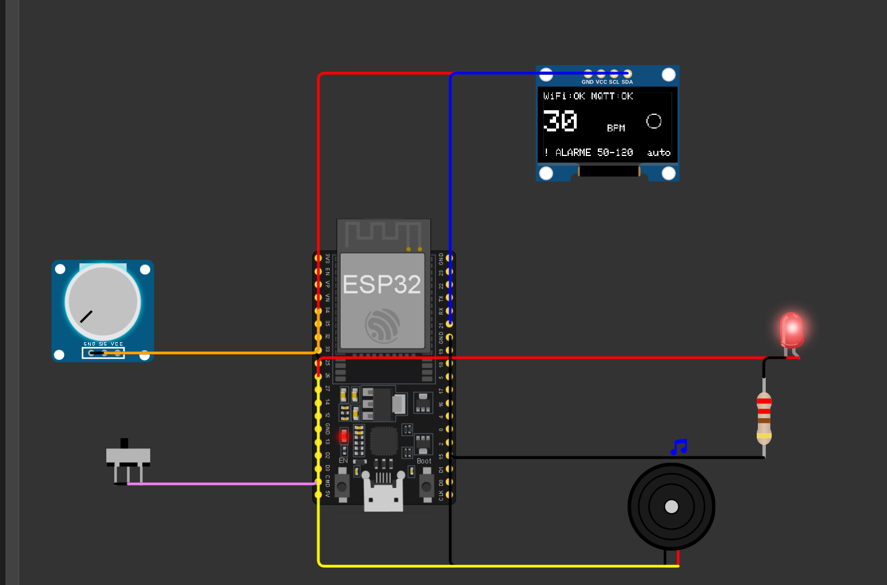
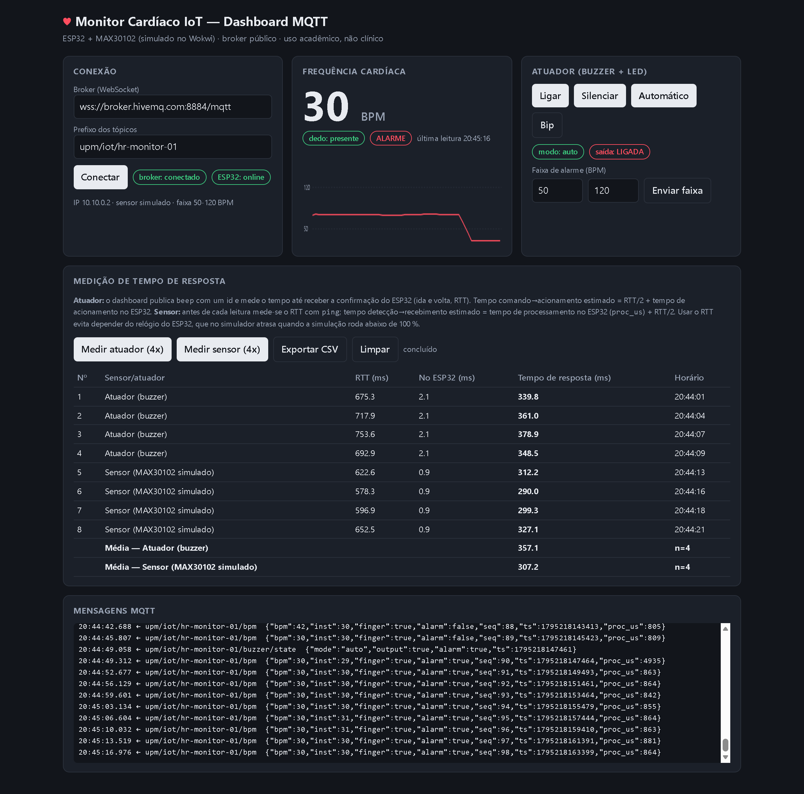

# Medição do tempo de resposta

## O que é medido

| Medida | Definição | Como é obtida |
|---|---|---|
| **Atuador** | tempo entre o envio do comando pelo dashboard e o acionamento do buzzer | dashboard publica `buzzer/set {"state":"beep","id":X}` e cronometra (`performance.now()`) até receber `buzzer/state` com o mesmo `id` (RTT). Tempo = RTT/2 + `act_us` |
| **Sensor** | tempo entre a detecção do batimento no ESP32 e o recebimento do dado no dashboard (cliente MQTT) | dashboard mede o RTT com `ping`/`pong`; ao receber a próxima leitura, tempo = `proc_us` + RTT/2 |

- `act_us`: medido no ESP32 com `micros()`, da chegada do comando até o GPIO ser acionado.
- `proc_us`: medido no ESP32, da detecção do batimento até a montagem da mensagem para publicação.
- RTT/2 estima o tempo de uma perna (ESP32 ↔ broker ↔ dashboard), supondo ida e volta simétricas.

O RTT foi preferido ao carimbo NTP (`ts`) porque, no Wokwi, o relógio do ESP32 simulado avança em
"tempo de simulação". Com a simulação abaixo de 100 % da velocidade real, a diferença entre `ts` e o
relógio do PC cresceu cerca de 1 s a cada poucos segundos nos testes. O RTT usa apenas o relógio do
navegador e não sofre esse desvio.

## Procedimento

1. Inicie a simulação no Wokwi e espere `[MQTT] conectado` no Serial Monitor. Mantenha a aba visível: em
   segundo plano a simulação desacelera e o MQTT desconecta.
2. Coloque a chave em "dedo presente".
3. Abra `dashboard/index.html`, conecte e clique em **Medir atuador (4x)** e **Medir sensor (4x)**.
4. Clique em **Exportar CSV** e rode `python tools/grafico_latencia.py medicoes_latencia.csv`.

## Resultados

Medições realizadas em 20/11/2026 (Wokwi → broker.hivemq.com; simulação entre 45 % e 62 % da velocidade real).
Dados brutos em [`img/medicoes_latencia.csv`](img/medicoes_latencia.csv).

| Nº medida | Sensor/atuador | RTT (ms) | No ESP32 (ms) | Tempo de resposta (ms) |
|---|---|---|---|---|
| 1 | Sensor (MAX30102 simulado) | 622,6 | 0,86 | 312,2 |
| 2 | Sensor (MAX30102 simulado) | 578,3 | 0,88 | 290,0 |
| 3 | Sensor (MAX30102 simulado) | 596,9 | 0,88 | 299,3 |
| 4 | Sensor (MAX30102 simulado) | 652,5 | 0,88 | 327,1 |
| | **Média — sensor** | | | **307,2** |
| 1 | Atuador (buzzer) | 675,3 | 2,12 | 339,8 |
| 2 | Atuador (buzzer) | 717,9 | 2,10 | 361,1 |
| 3 | Atuador (buzzer) | 753,6 | 2,06 | 378,9 |
| 4 | Atuador (buzzer) | 692,9 | 2,10 | 348,6 |
| | **Média — atuador** | | | **357,1** |

Quase todo o tempo vem da rede: gateway do Wokwi, internet e broker público. O processamento no ESP32 fica
abaixo de 1 ms no sensor e em cerca de 2 ms no atuador.

## Capturas

| Estado normal (74 BPM) | Alarme (30 BPM) |
|---|---|
|  |  |

