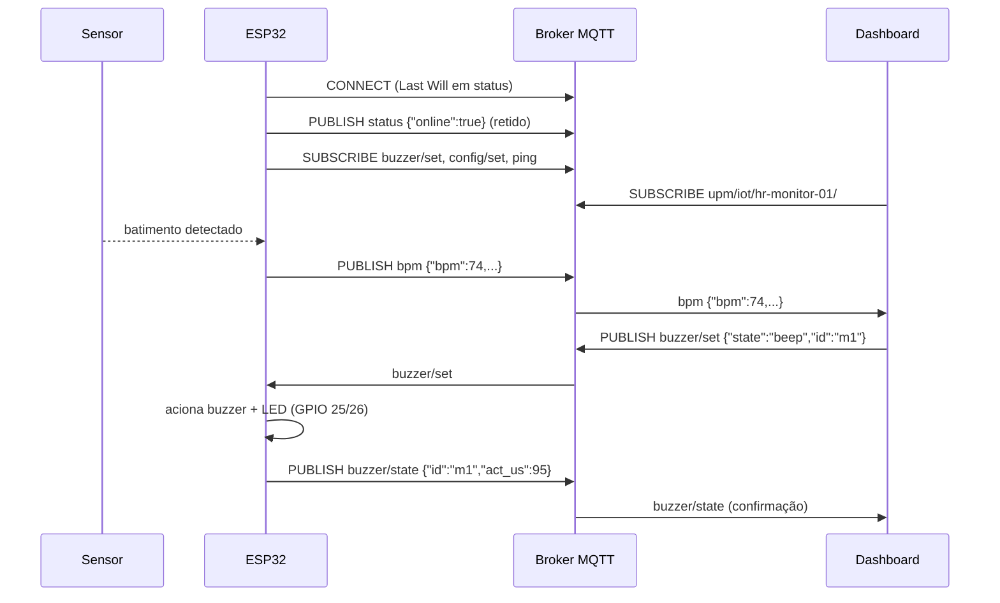

# Protocolo MQTT, interfaces e módulos de comunicação

## Visão geral

O MQTT (*Message Queuing Telemetry Transport*) é um protocolo de mensagens leve, padronizado pela OASIS,
que funciona sobre TCP/IP no modelo **publicação/assinatura** (*publish/subscribe*). Os clientes não
conversam diretamente: um **broker** recebe cada mensagem publicada em um **tópico** e a entrega a todos os
clientes inscritos nele.

Neste projeto:

| Papel | Quem | Transporte |
|---|---|---|
| Cliente publicador/assinante | ESP32 (biblioteca PubSubClient, MQTT 3.1.1) | Wi-Fi 802.11 b/g/n → TCP porta **1883** |
| Broker | `broker.hivemq.com` (público, gratuito) | — |
| Cliente publicador/assinante | Dashboard web (MQTT.js) | WebSocket seguro **wss://…:8884/mqtt** |

O ESP32 já tem Wi-Fi integrado, então não há módulo de comunicação separado nem ponte serial-USB: o
firmware fala TCP/IP diretamente pela pilha lwIP do ESP-IDF. No Wokwi, o ESP32 simulado entra na rede
`Wokwi-GUEST`, que encaminha o tráfego para a internet real, de modo que as mensagens chegam ao mesmo
broker público usado pelo dashboard.

## Interfaces de hardware

| Interface | Barramento | Pinos ESP32 | Dispositivo |
|---|---|---|---|
| I2C (400 kHz) | SDA/SCL | GPIO 21 / GPIO 22 | MAX30102 (0x57) e OLED SSD1306 (0x3C) |
| ADC1 (12 bits) | analógico | GPIO 34 | potenciômetro (somente simulação) |
| Entrada digital com pull-up | digital | GPIO 27 | chave "dedo presente" (somente simulação) |
| Saída digital / PWM (`tone`) | digital | GPIO 25 | buzzer (físico: base do BC547 via 200 Ω) |
| Saída digital | digital | GPIO 26 | LED vermelho + 220 Ω |
| UART0 115200 bps | serial | USB | logs de depuração |

## Tópicos

Prefixo padrão: `upm/iot/hr-monitor-01` (configurável em `TOPIC_BASE`).

| Tópico | Direção | QoS | Retido | Conteúdo |
|---|---|---|---|---|
| `<base>/bpm` | ESP32 → | 0 | não | leitura a cada batimento; sem dedo, a cada 2 s |
| `<base>/status` | ESP32 → | 1 | sim | `{"online":true,...}`; Last Will `{"online":false}` |
| `<base>/buzzer/state` | ESP32 → | 0 | sim | estado do atuador; ecoa o `id` do comando |
| `<base>/buzzer/set` | → ESP32 | 1 | não | comando do atuador |
| `<base>/config/set` | → ESP32 | 1 | não | faixa de alarme |
| `<base>/ping` | → ESP32 | 0 | não | pedido de eco (medição de RTT) |
| `<base>/pong` | ESP32 → | 0 | não | eco do payload de `ping` |

## Mensagens (JSON)

`<base>/bpm`
```json
{"bpm":74,"inst":75,"finger":true,"alarm":false,"seq":42,"ts":1795207790123,"proc_us":180}
```
- `bpm`: média móvel dos 4 últimos intervalos; `inst`: valor instantâneo do último intervalo
- `ts`: hora UTC (ms desde 1970) da publicação, via NTP; `0` se o relógio não sincronizou
- `proc_us`: tempo, em µs, entre a detecção do batimento e a montagem da mensagem no ESP32

Sem dedo: `{"bpm":0,"finger":false,"alarm":false,"ts":...}`

`<base>/status`
```json
{"online":true,"ip":"10.10.0.2","sensor":"simulado","min":50,"max":120}
```

`<base>/buzzer/set` — `state` ∈ `on` (liga fixo), `off` (silencia), `auto` (segue o alarme), `beep` (bip de 300 ms).
Também aceita texto puro (`on`, `off`...).
```json
{"state":"beep","id":"m1795207790000"}
```

`<base>/buzzer/state`
```json
{"mode":"auto","output":true,"alarm":false,"id":"m1795207790000","act_us":95,"ts":1795207790210}
```
- `output`: se o buzzer/LED está ligado agora
- `act_us`: tempo entre a chegada do comando no ESP32 e o acionamento do GPIO

`<base>/config/set`
```json
{"min":50,"max":120}
```

## Sequência de mensagens



## Decisões de projeto

- **QoS 1 para comandos** e status: garante que o comando chegue ao menos uma vez. Leituras de BPM usam
  QoS 0, pois chegam a cada segundo e uma perdida é substituída pela próxima.
- **Mensagens retidas** em `status` e `buzzer/state`: um dashboard que se conecta depois já recebe o
  último estado conhecido.
- **Last Will and Testament**: o broker avisa que o dispositivo caiu sem depender do próprio dispositivo.
- **Keep-alive de 15 s** e reconexão automática a cada 3 s no firmware.
- **`id` em cada comando**: permite casar comando e confirmação e medir o tempo de ida e volta.

## Segurança

O broker público é adequado apenas para demonstração com dados simulados. Para dados reais de saúde:
broker privado (Mosquitto, HiveMQ Cloud, EMQX), TLS (porta 8883, `WiFiClientSecure`), autenticação por
usuário/senha ou certificado e ACL por tópico.
